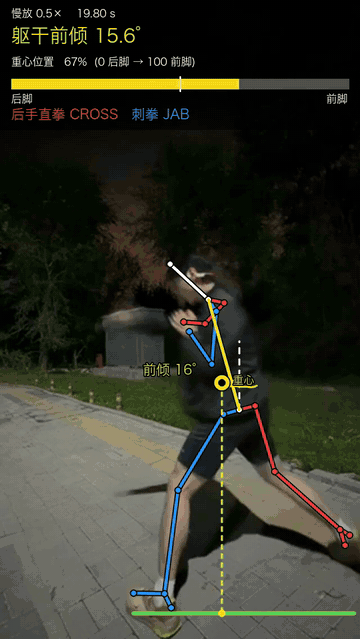
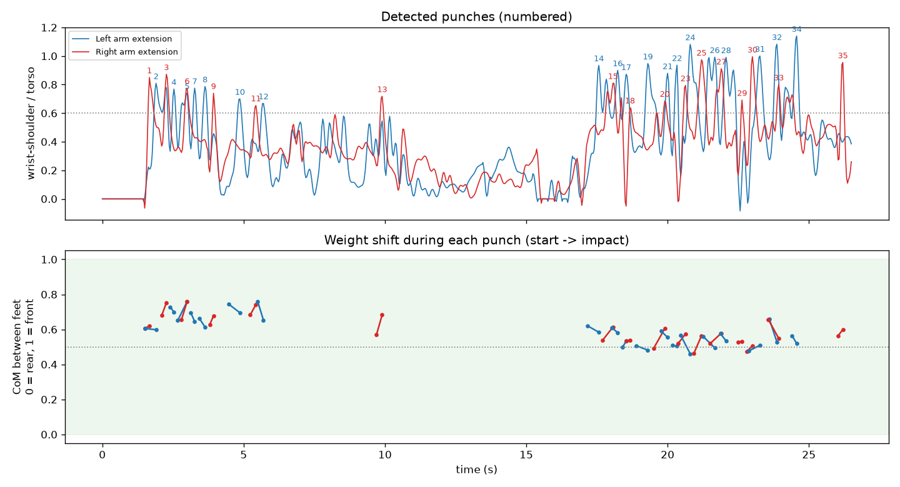
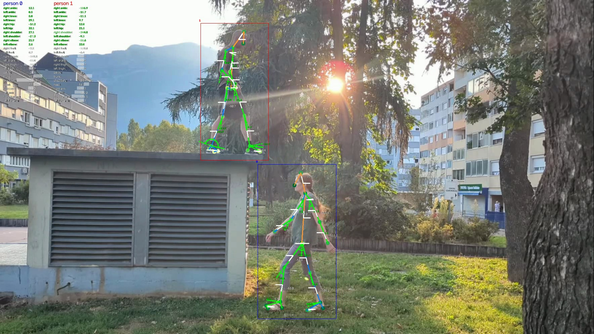
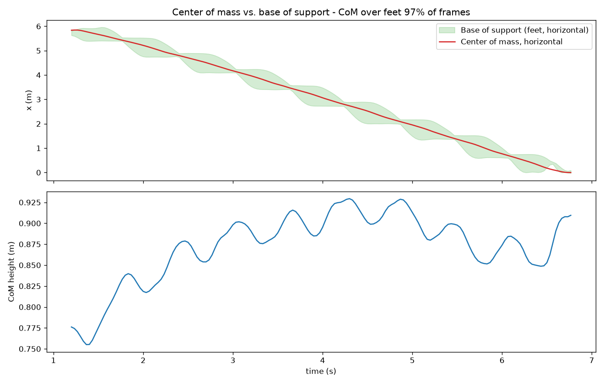

# Boxing Pose Analysis · 拳击动作与重心分析

用一部手机拍的训练视频，自动提取人体骨架，分析**出拳时的重心转移、躯干倾斜和发力顺序**，并生成带标注的慢放视频。

> 这是我探索具身智能方向的个人项目：先把"人体运动"变成可度量的关节和重心数据，再思考这些数据如何迁移到人形机器人。

<p align="center">
  
  <br>
  <sub>0.5× 慢放（空击组合段）：黄色靶心 = 身体重心，虚线 = 重心铅垂线，绿线 = 支撑面，顶部 = 躯干倾斜与重心位置</sub>
</p>



## 为什么做这个

| 用户 | 痛点 |
|---|---|
| 业余拳击 / 健身爱好者 | 看不见自己出拳时重心在哪、有没有"探身"，只能靠教练口头提醒 |
| 教练 | 一次带多个学员，无法逐拳盯每个人的重心和转髋 |

**核心假设**：只用一部手机、不穿任何传感器，就能给出足够有用的重心与姿态反馈。

## 能做什么

- **骨架提取**：关节点 + 骨骼连线（左蓝、右红）
- **出拳检测**：自动识别每一拳，并按站架区分刺拳 / 后手直拳
- **重心分析**：按 Winter 人体参数表加权计算全身重心，给出"重心在两脚之间的位置"（0 = 后脚，1 = 前脚）
- **躯干倾斜**：髋→颈连线与竖直方向的夹角，区分前倾 / 后仰
- **慢放标注视频**：0.5× 慢放，每一帧标出骨架、重心（铅垂线 + 轨迹）、支撑面、倾斜角度和出拳类型

| 骨架提取（Sports2D 示例视频） | 重心 vs 支撑面（走路示例） |
|---|---|
|  |  |

## 快速开始

需要 macOS / Linux、[uv](https://github.com/astral-sh/uv) 和 ffmpeg（`brew install uv ffmpeg`）。

```bash
uv venv --python 3.12 .venv
VIRTUAL_ENV=.venv uv pip install -r requirements.txt
```

分析一段视频（身高单位米，站架默认正架）：

```bash
scripts/run.sh videos/my_shadowboxing.mp4 1.75 orthodox
```

输出在 `results/<视频名>/`：

| 文件 | 内容 |
|---|---|
| `<名>_slowmo_CoM.mp4` | 0.5× 慢放标注视频 |
| `analysis/punches.txt` / `punches.png` | 逐拳数据：时间、出拳距离、重心转移、髋/肩领先时间 |
| `analysis/center_of_mass.png` | 重心轨迹与支撑面 |
| `analysis/joint_angles.png` / `angle_summary.csv` | 关节角度曲线与范围 |

**拍摄建议**：正侧面、手机与腰同高并固定、全身含脚入镜、光线充足；用原文件（别经过微信压缩）；有条件开 60/120fps。

## 流程

```
手机视频 → Sports2D（RTMPose 关节点 + 滤波） → 关节坐标 / 角度
        → analyze.py        重心（Winter 表）、关节角度
        → punch_analysis.py 出拳检测、重心转移、发力顺序
        → render_overlay.py 慢放标注视频
```

| 脚本 | 作用 |
|---|---|
| `scripts/run.sh` | 一条命令跑完整流程 |
| `scripts/analyze.py` | 重心计算、关节角度图 |
| `scripts/punch_analysis.py` | 出拳检测与逐拳指标 |
| `scripts/render_overlay.py` | 生成慢放标注视频 |

## 第一次实测（26 秒空击，正架）

🎬 **[下载完整 0.5× 慢放标注视频](https://github.com/z2302743489/boxing-pose-analysis/releases/download/v0.1/shadowboxing_slowmo_CoM.mp4)**（53 秒，骨架 + 重心 + 躯干倾斜 + 出拳类型；页面顶部动图是其中 20–25 秒的组合段）

- 检测到 35 拳（刺拳 19、后手直拳 16）；35 拳全部左脚在前，站架可自动推断
- **后手直拳**平均把重心向前送 +0.05（最多 +0.11），**刺拳**基本不动重心（−0.03）
- 出拳瞬间重心始终在两脚之间（0.46–0.76），没有扑出前脚
- 后段出拳更远，但躯干前倾从约 10° 增加到约 18°，重心反而回到中间 → 更多靠"探身"而非脚下跟进

## 关键决策与取舍

| 决策 | 理由 | 代价 |
|---|---|---|
| 单手机摄像头，不用动捕 / 可穿戴 | 使用门槛最低，用户已有设备 | 只有 2D，深度方向有透视误差 |
| 用"重心在两脚间的比例"而非绝对坐标 | 与身高、机位距离无关，用户一看就懂 | 双脚重叠（转身）时无法计算 |
| 重心比例只用水平方向 | 低机位斜拍时前脚在画面里更低，2D 投影会让比例偏到 0.1 左右（实测踩坑） | 忽略了深度方向的分量 |
| 出拳需"拳在肩高附近 + 水平伸出" | 去掉手臂自然下垂、背对镜头造成的误检（实测 3 处） | 上勾拳等向上的拳会漏检 |
| 由前脚自动推断站架 | 少一个设置项；本次 35/35 一致 | 频繁换架时需逐拳判断 |
| 固定 Sports2D 0.8.34 | 该版本"保存图表但不显示"会崩溃且不生成视频，绕过方式与版本相关 | 升级前需复测 |

## 已知局限

- **手臂角度不可信**：手臂与身体重叠、运动模糊时肘角会跳变
- **发力顺序（髋→肩→拳）在 30fps 下分辨不出**：一拳只有 4–12 帧，每帧 33 ms；需要 120fps 才有意义
- **2D 单目**：朝镜头前后移动时有透视误差；可靠的 3D 重心需要多机位（Pose2Sim / freemocap）或单目 3D 重建（GVHMR）
- 重心依赖人体参数表的平均值，未按个人体型校准

## 下一步

1. **120fps 慢动作**验证后手直拳是否"先转髋再出拳"
2. **单目 3D**（GVHMR / WHAM）替换 2D，去掉透视误差
3. **实时反馈**：手机端 MediaPipe + 语音提示（"重心太靠前""别探头"）
4. **连接具身智能**：把人体动作经 [GMR](https://github.com/YanjieZe/GMR) 重定向到人形机器人，参考 [KungfuBot](https://github.com/TeleHuman/PBHC) 用强化学习学出拳；"重心在支撑面内"正是机器人平衡控制的核心约束

## 致谢

- [Sports2D](https://github.com/davidpagnon/Sports2D)（BSD-3）— 2D 姿态与角度
- [RTMPose / rtmlib](https://github.com/Tau-J/rtmlib) — 关节点检测
- [freemocap](https://github.com/freemocap/freemocap) — 重心计算方法参考
- Winter, D. A. *Biomechanics and Motor Control of Human Movement* — 人体参数表
